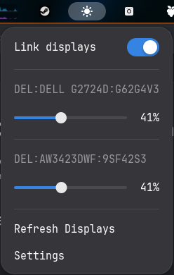

# DDC Controle de Brilho e Contraste

Extensão para GNOME que controla o brilho e o contraste de monitores externos
compatíveis com DDC/CI, diretamente pelo menu superior do sistema.



## Recursos

- Um controle deslizante de **Brilho** (VCP `10`) por monitor.
- Um controle deslizante de **Contraste** (VCP `12`) por monitor.
- Faixa de `0%` a `100%`; quando o monitor não informar um valor inicial, o
  controle começa em `50%`.
- Atalhos de teclado para brilho no monitor ativo.
- Opção de vincular o mesmo controle em todos os monitores.
- Atualização da lista de monitores pelo próprio menu.

## Créditos e licença

Este projeto é um fork de
[DDC Brightness Control, de Lucas Oskorep](https://github.com/lucasoskorep/ddc-brightness-control).
O projeto original foi usado como base e a interface foi ampliada para oferecer
controle de contraste separado. O código permanece sob a licença GPL-3.0.

## Requisitos

- GNOME Shell 50 ou 51.
- Um monitor externo com suporte a DDC/CI.
- `ddcutil` e acesso do usuário ao grupo `i2c`.

No Ubuntu/Debian:

```bash
sudo apt install ddcutil i2c-tools
sudo usermod -aG i2c "$USER"
```

Depois de adicionar o grupo, encerre e entre na conta novamente uma única vez.
Isso é necessário para que a nova permissão `i2c` seja aplicada ao seu usuário.

Para conferir se o monitor expõe os dois controles:

```bash
ddcutil getvcp 10 12
```

## Instalação a partir deste repositório

```bash
git clone https://github.com/mateusdata/DDC-ubuntu.git
cd DDC-ubuntu
pnpm install --frozen-lockfile
pnpm run build
```

Compile o esquema e copie a extensão:

```bash
mkdir -p dist/schemas
cp metadata.json stylesheet.css dist/
cp schemas/org.gnome.shell.extensions.ddcbrightness.gschema.xml dist/schemas/
glib-compile-schemas dist/schemas
mkdir -p ~/.local/share/gnome-shell/extensions/ddcbrightnesscontrast@data.local
cp -r dist/. ~/.local/share/gnome-shell/extensions/ddcbrightnesscontrast@data.local/
```

Abra o **Gerenciador de Extensões**, atualize a lista e ative **DDC Controle de
Brilho e Contraste**. Para instalações locais feitas manualmente, o GNOME pode
precisar de uma atualização da lista de extensões; isso não significa que o
Linux inteiro precise ser reiniciado.

## Desenvolvimento

Depois de instalar as dependências, use:

```bash
pnpm run build
pnpm run lint
```

Os controles ficam em `src/indicator.ts`; a comunicação DDC/CI fica em
`src/displays.ts` e `src/ddcutil.ts`. Para adicionar outro ajuste de monitor,
crie um novo controle com o respectivo código VCP e use a mesma estrutura dos
controles de brilho e contraste.
